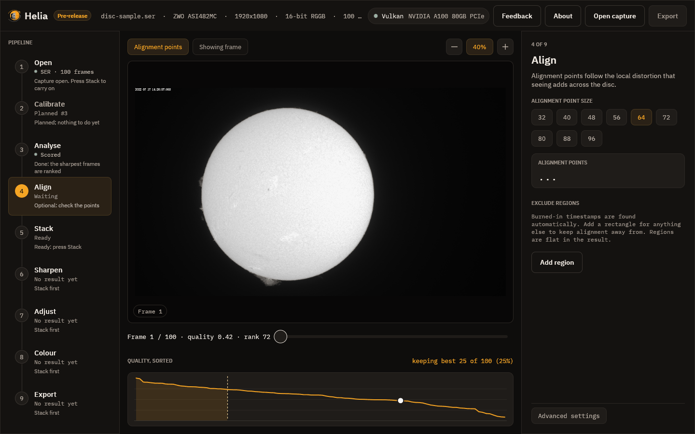
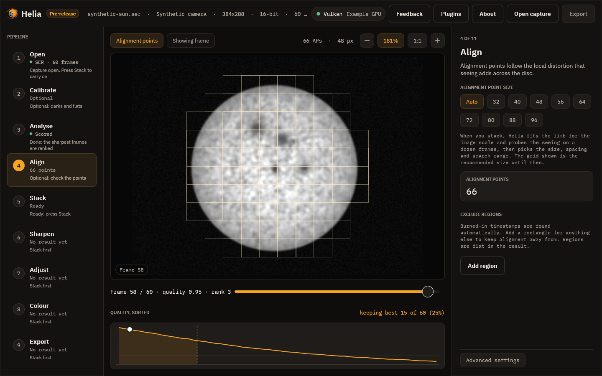
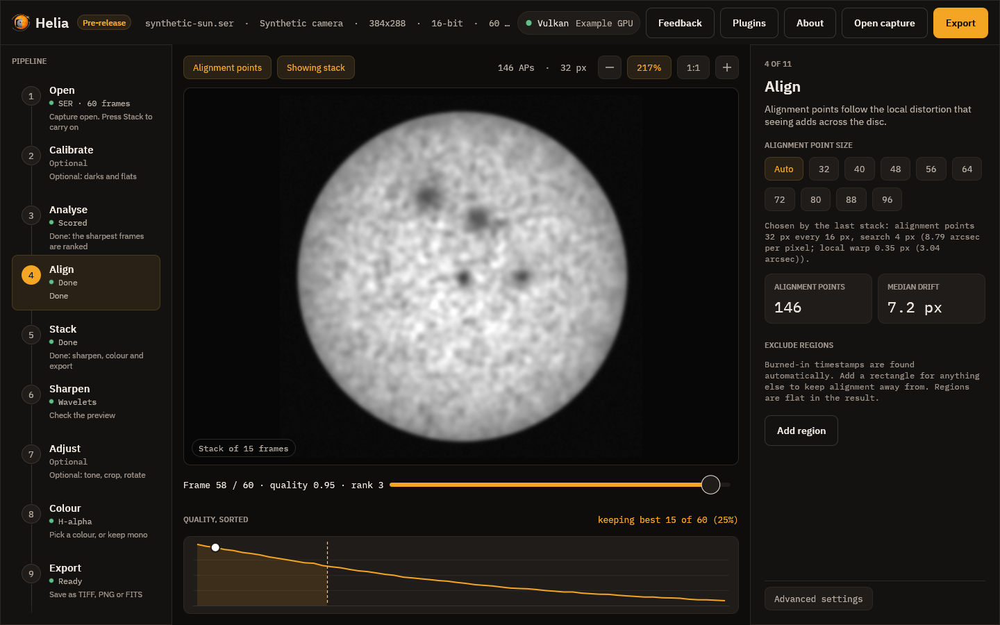
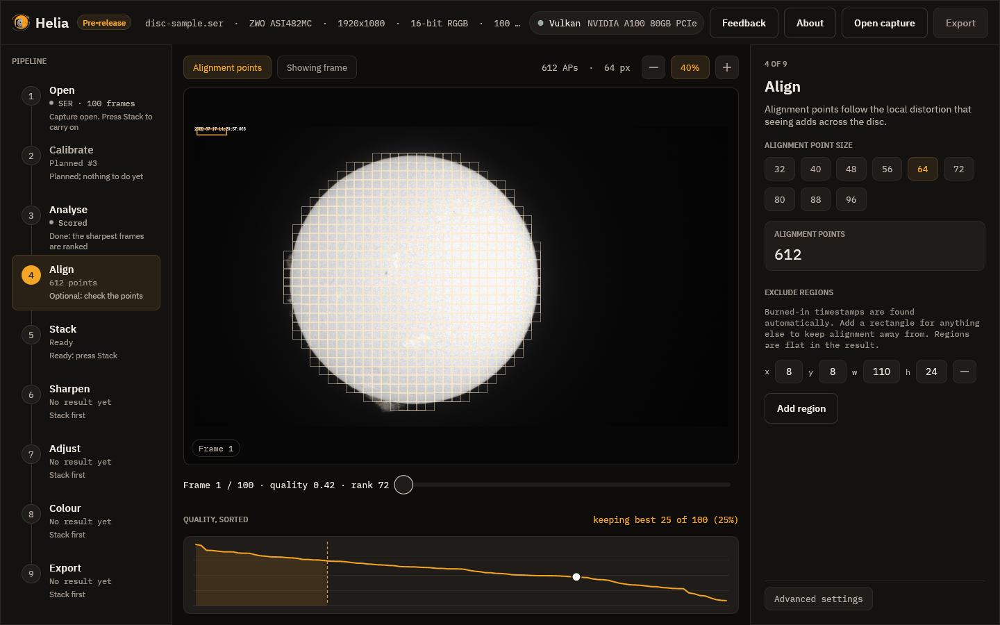

# 4. Align

The air bends the picture differently across the disc from moment to moment, so
Helia does not only line the whole frame up with the others. It also measures the
drift of many small windows, the **alignment points** (APs), and shifts each part
of each frame separately. This step shows and controls those windows.

## The grid

Turn the grid on with the **Alignment points** chip above the picture. Each thin
square is one alignment point. In the picture there are 612 of them, 64 pixels
across, laid over the disc only: a point is drawn only where the stack will use it,
which means its centre is inside the fitted limb of the Sun, and no part of it
touches burned-in text or a region you excluded.

## Point size

The inspector offers sizes from 32 to 96 pixels in steps of 8. The size Helia
recommends for your image is already selected (64 here, 32 for the smaller H-alpha
AVI).

* **Smaller points** follow finer detail and distortion, but need contrast to lock
  on to. On a smooth, low-contrast area they cannot, and Helia marks them
  inactive.
* **Larger points** are steadier on soft detail but average the distortion over a
  wider patch.

The card shows how many points are active, that is bright and detailed enough to
measure. After a stack, a second card shows the median drift of the frames from
the reference, in pixels.

## Auto

The **Auto** chip lets Helia choose when it stacks, instead of a fixed size. It
fits the limb of the reference to get the image scale in arcseconds per pixel,
registers a dozen of the frames it will stack and measures how far each
alignment point strays from its frame's median shift, then picks the window, its
spacing and how far to search. The line under the chips says what to expect, and
after a stack what was chosen. Picking a size turns Auto off.

After a stack the grid drawn on the frame is the chosen size.

These pictures are of a synthetic capture. The note reads, for instance,
*Chosen by the last stack: alignment points 32 px every 16 px, search 4 px (8.79
arcsec per pixel; local warp 0.35 px (3.03 arcsec)).* How the choice is made and
how it measured on real captures is in
[How stacking works](../user-guide/how-stacking-works.md#choosing-the-points-automatically).

## Exclude regions

A burned-in capture timestamp is found automatically (look at the top left of the
frame: Helia kept the grid off the date text). For anything else, such as a logo
or a stray label, press **Add region**, then set its `x`, `y`, width `w` and height
`h` in pixels. The rectangle is outlined in amber on the frame, and alignment and
quality scoring stay off it.

Excluded areas are flat in the stacked result, so do not exclude part of the Sun
you care about. Use the minus button to remove a region. Changing the list scores
the capture again, because the scores depend on it.

## How whole frames are aligned

Before the points, each whole frame is lined up with a reference. Helia chooses:

* the **solar limb** when the full disc is in view and the fit is confident, which
  uses the edge of the Sun and so ignores sunspots and the timestamp;
* **phase correlation** for a cropped region, where there is no whole disc to fit.

After a stack, a line under the Stack button says which was used and how
confident it was, for example *Aligned by limb fit, confidence 0.90*; hover it for
the reason. The app has no switch for it. To force one, use `--align limb` or
`--align phase` on the command line, or `align` in an API job.

## Prominences

By default points stay on the disc. To let them follow prominences just outside
the limb, use `--prominence-band PX` on the command line.

## Next

[Stack](05-stack.md).
