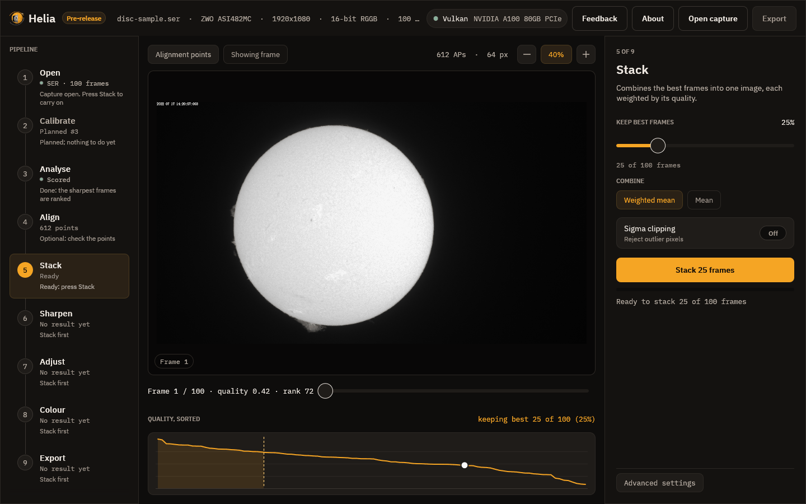
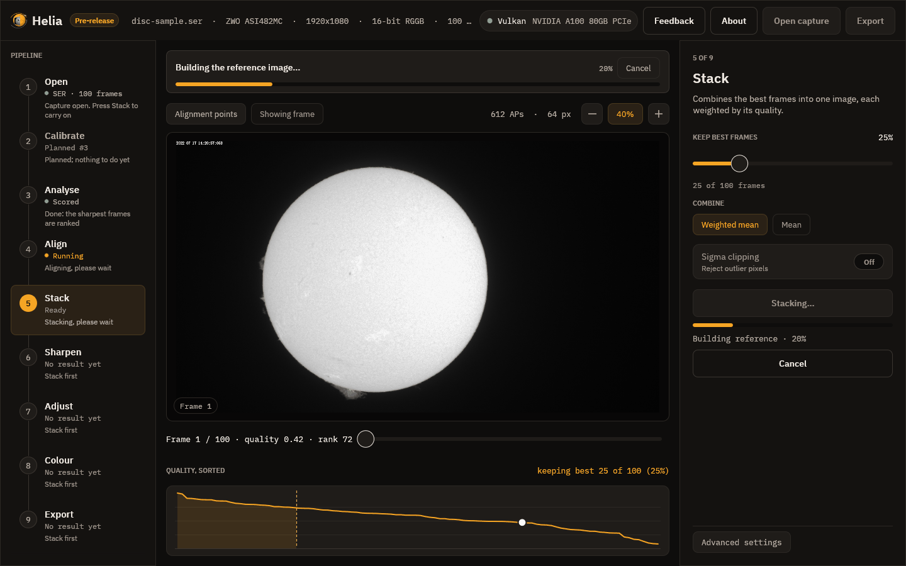
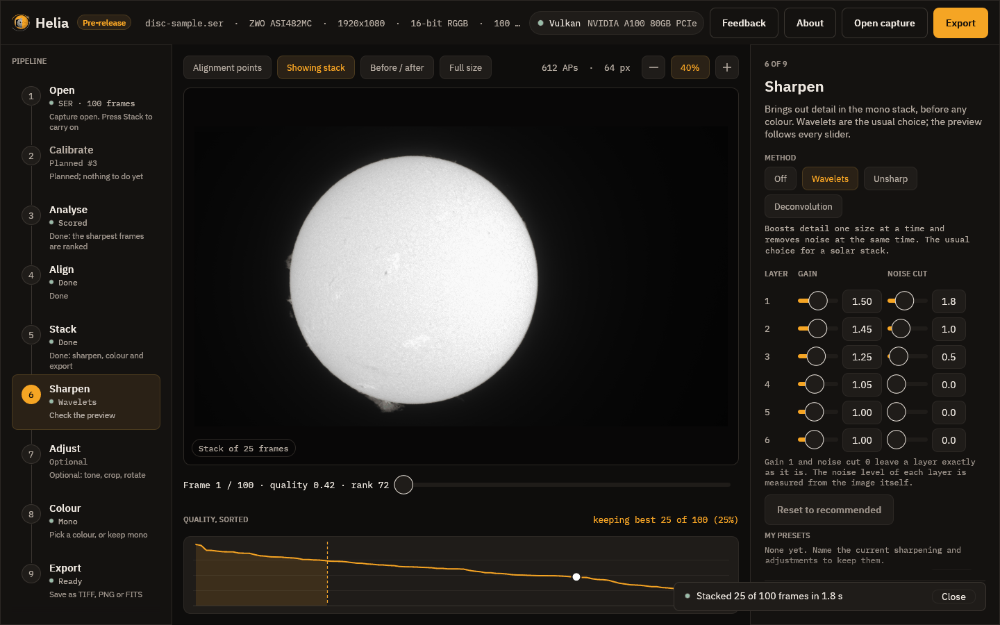

# 5. Stack

This step holds the settings of the combine, and the button that runs it.

## The settings

* **Keep best frames** is the share of frames, ranked by quality, that go into the
  stack, from 5 to 100 per cent in steps of 5. The line underneath turns it into a
  count: here 25 per cent of 100 frames is 25. Fewer frames means a sharper but
  noisier picture; more means smoother and softer. The recommended share for a
  filter is the best starting point: 25 per cent for H-alpha, sodium, He D3 and
  white light, 30 per cent for the fainter lines (see
  [Colour presets](../reference/presets-table.md)).
* **Combine** is a **weighted mean**: each kept frame counts in proportion to its
  quality. A plain mean is listed but not available yet.
* **Outliers** deals with pixels that are far from the others, such as a passing
  bird or a hot pixel: *Sigma* throws them out, *Huber* gives them less weight and
  *Winsor* pulls them in. It is off by default and makes the run slower.
* **Colour** is **Filter look** (one plane, coloured later in the Colour step) or
  **True colour**, which stacks red, green and blue of a raw colour capture on one
  alignment and balances them: for white light. Its **Auto balance** or **No
  balance** and **Align channels** (red and blue onto green, for atmospheric
  dispersion) appear when it is chosen, and the chip is disabled for a capture
  that is not a Bayer mosaic. See [True colour](../user-guide/colourising.md#true-colour).

  
* **Crop** is **Off** (the whole frame) or **Disc**, which cuts the result to a
  square around the fitted solar disc with a margin you set (10 per cent of the
  radius to start with; prominences seldom reach 5 per cent). The note under it
  says what will happen and, after a stack, the size it was cropped to. A
  capture with no clear disc is left whole and the note says so.
* **Stack N frames** starts the run.

## While it runs

A notice above the picture names the stage, shows the percentage and the time
left, and has a **Cancel** button; the thin bar in the inspector shows overall
progress. Cancelling stops the run without losing your settings. These are the
stages:

1. *Scoring the frames*, if not already done.
2. *Building the reference image*: a first stack of the best frames to align
   against.
3. *Aligning the frames*: the whole-frame step.
4. *Measuring the alignment points*: each point's drift in each frame.
5. *Stacking the best frames*: the weighted mean with every point's shift applied.
6. *Finishing the image*.

## The result

When it finishes, a message reports the frames used and the time taken, the viewer
switches to the stacked image, **Export** lights up and Helia moves on to Sharpen.

The stack is mono. It looks soft compared with a good single frame at first
glance, and that is expected: it is smooth because the noise has been averaged
away, and the sharpening step is where the fine detail is brought back. For how
the maths works, see [How stacking works](../user-guide/how-stacking-works.md).

## Next

[Sharpen](06-sharpen.md).
