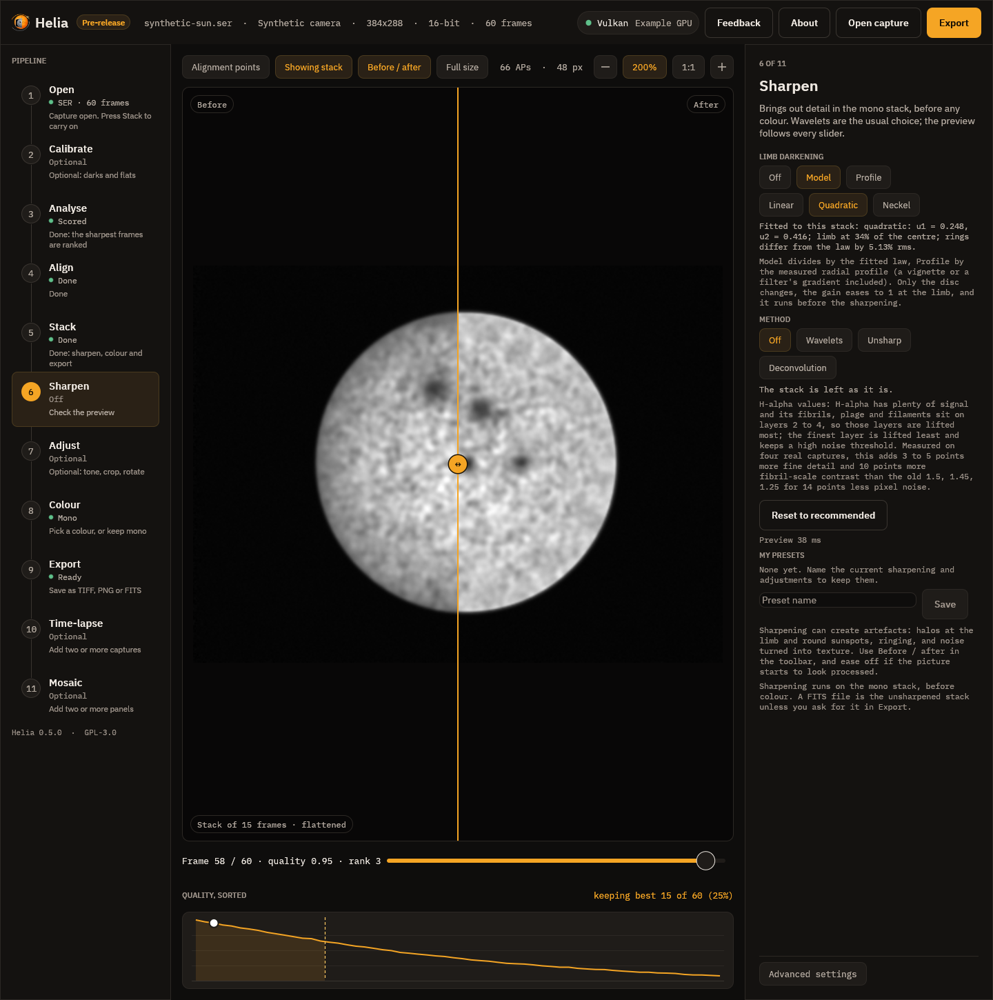
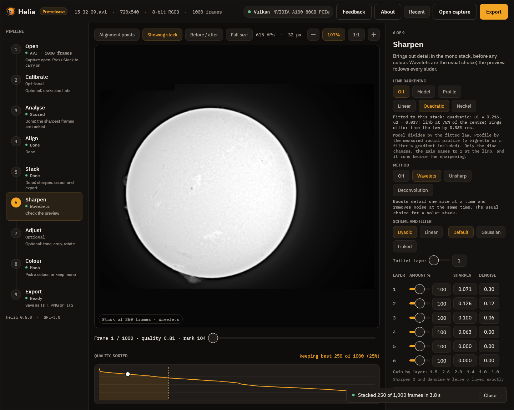
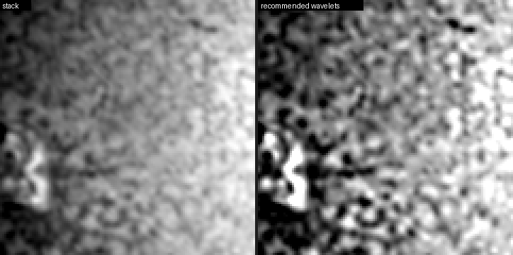
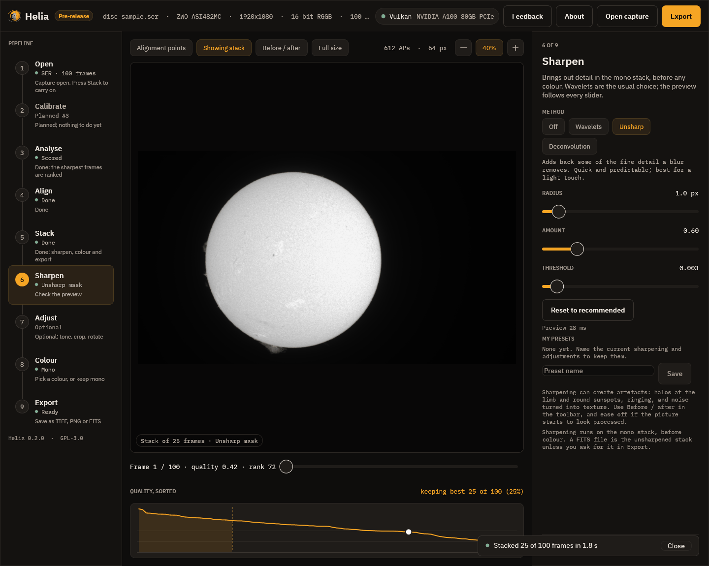
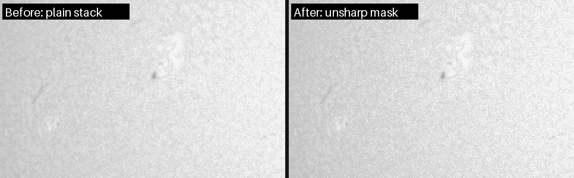
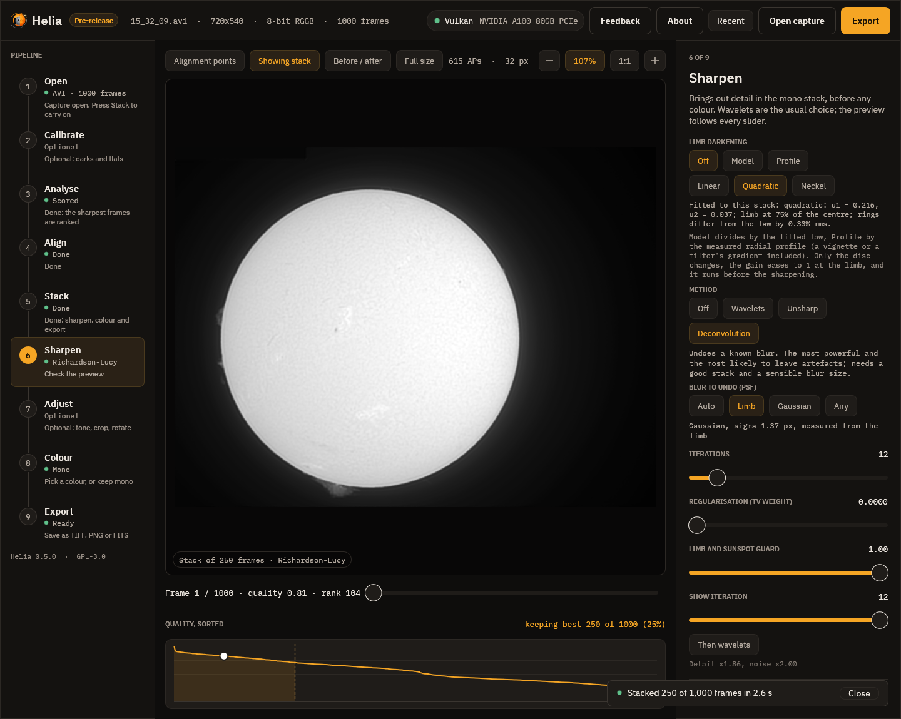
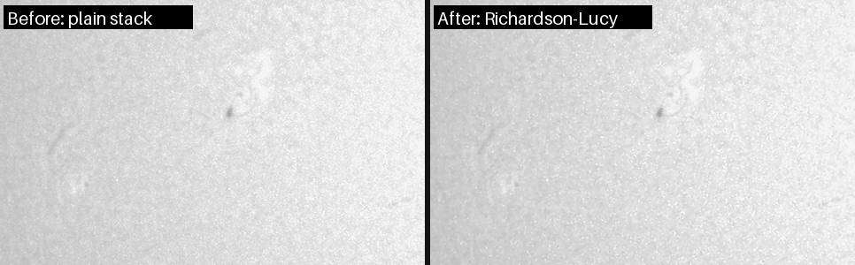

# 6. Sharpen

A stack is clean but soft. This step brings the fine detail back. It works on the
mono stack, before any colour, and is **non-destructive**: your choices are a list
of operations applied to the stack for the preview and again, at full size, when
you export.

> **Sharpening can create artefacts.** Halos beside bright edges, ringing at the
> limb and round sunspots, and noise that turns into a texture that looks like
> detail. None of the methods can add detail that the telescope and the seeing did
> not record. Ease off as soon as the picture looks different in kind rather than
> just crisper.

## Limb darkening

The first control is **Limb darkening**: **Off**, **Model** or **Profile**, and
the law to fit (Linear, Quadratic, Neckel). The line under the chips is the fit
made on your stack, for example *quadratic: u1 = 0.470, u2 = 0.046; limb at 48% of
the centre; rings differ from the law by 0.67% rms*. **Model** divides the disc
by that law and **Profile** by the measured radial profile, so the sharpening
below sees flat contrast from the centre to the limb. Only the disc changes. It is
off by default; try it with **Before / after**, and see
[Limb darkening](../user-guide/sharpening.md#limb-darkening) for what the fit
measures on real captures.

## The method chips

The row of chips at the top picks the method: **Off**, **Wavelets**, **Unsharp** or
**Deconvolution**. Helia has already switched on the recommended wavelets for your
filter, so the picture you see when you arrive is sharpened. Press **Off** to see
the plain stack. Every slider updates the picture as you drag it, and a line says
how long the last preview took (a few tens of milliseconds in the picture).

Three chips above the picture help you judge: **Before / after** splits the picture
at a line you can drag (the stack as it was on the left, with your edits on the
right), **Full size** keeps the preview at full size while you drag (otherwise it
is shrunk while you drag and made again at full size when you let go), and **1:1**
shows the picture at 100%. A preview is a close look, not a proof: what is written
is always made from the full-size stack.

## Wavelets

The image is split into six layers by the size of detail. Layer 1 holds the finest
detail and most of the noise, layer 2 fine detail such as granulation and
fibrils, and higher layers bigger structure. The controls are those of RegiStax 6,
and a user of that program will find the same things in the same order:

* **Dyadic or Linear**, an **Initial layer** and (for Linear) a **Step**: how the
  layer sizes grow.
* **Default or Gaussian**: the smoothing kernel.
* **Linked**: each layer works on the result of the finer ones.
* For each layer an **Amount %** slider (the RegiStax layer slider, 0 to 200), a
  **Sharpen** value (gain 1 + amount x sharpen squared: 0.14 is 3x, 0.5 is 26x,
  1 is 101x at 100%) and a **Denoise** value (detail weaker than ten times it, in
  noise sigmas, is removed).

Under the grid a line gives the gain of each layer. The recommended values for a
filter are in
[Sharpening and adjustments](../user-guide/sharpening.md#recommended-values-for-each-filter).
**Reset to recommended** puts them back. The mapping from RegiStax, and a worked
example, are in [Coming from RegiStax](../user-guide/coming-from-registax.md) and
[Sharpening like RegiStax](../recipes/sharpening-like-registax.md).

Here is the effect of the recommended wavelets on a real H-alpha stack (250 of
1,000 frames of `15_32_09.avi`). This is a 120 pixel crop at 3x, the plain stack
on the left and the recommended wavelets on the right:

The mottling and the filament at the left are much crisper. Measured over the
disc-centre crop, the band of 1 to 4 pixel detail rises from 0.96% to 2.17% of the
mean, about 2.3 times, and the pixel-scale band (mostly noise) from 0.30% to
0.62%, about 2 times. That is the point of the numbers: the detail goes up faster
than the noise rises, and the noise cut on layer 1 keeps the grain from taking
over. If the picture looks processed rather than just crisp, lower the sharpen of
layer 2 or raise the denoise of layer 1.

## Unsharp mask

The **radius** is the size of the blur that is subtracted, which picks the size of
detail that is boosted. The **amount** is how much of the difference is added back
(0.6 is gentle, 2 strong). The **threshold** leaves weaker detail alone so noise is
not boosted. It is a light, predictable touch:

## Deconvolution

Richardson-Lucy deconvolution tries to undo the blur itself, by repeated
correction. It has the blur to undo (the PSF), the number of iterations, a noise
control and a **limb and sunspot guard** that stops the bright halo that a bright
edge would otherwise grow. It is the strongest and the riskiest method.

On this capture it gains little and makes the grain coarser, which is why wavelets
are the default: stop when noise starts to look like texture. The page
[Sharpening and adjustments](../user-guide/sharpening.md) has the measurements on
four real captures.

## My presets

**My presets**, below the controls, keeps the whole set of sharpening and
adjustments under a name. Type a name and press **Save**; press a preset to use it.
The command line takes the same presets with `--edits`.

## Next

[Adjust](07-adjust.md).
