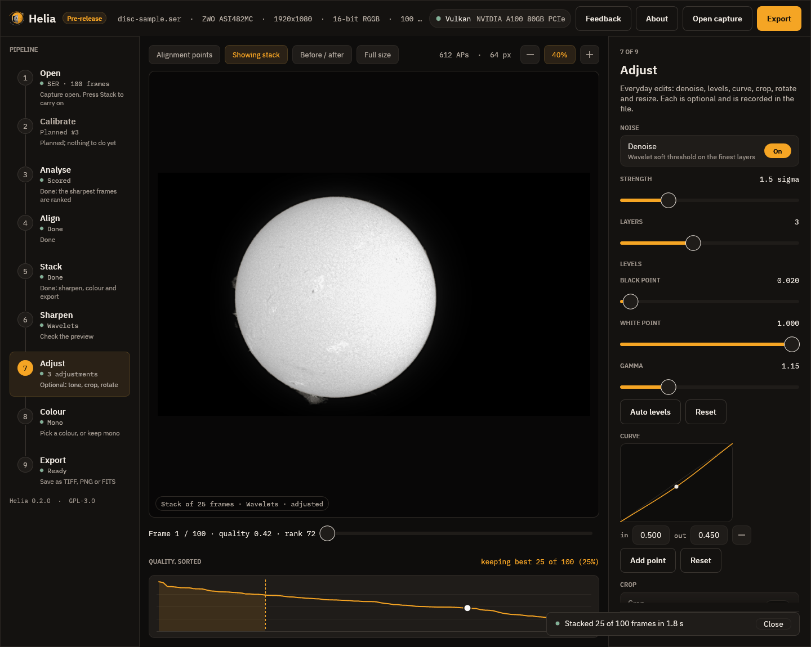

# 7. Adjust

Everyday edits, each optional and each recorded in the file. They are applied
after the sharpening, in a fixed order: denoise (before the sharpening), levels,
curve, crop, rotate, flip, resize.

The screenshot has three adjustments switched on, which the rail counts (*3
adjustments*) and the pill at the foot of the picture mentions (*adjusted*).

* **Denoise** is a soft threshold on the finest wavelet layers. *Strength* is the
  threshold on layer 1 in noise sigmas (1.5 here) and *Layers* is how many layers
  it treats. It lowers noise on flat sky a good deal and leaves the contrast of a
  sharp edge alone.
* **Levels**: a **black point**, a **white point** and a **gamma**. Raising the
  black point a little (0.02 here) deepens the sky; a gamma above 1 (1.15) brightens
  the mid-tones. **Auto levels** sets the points to the 0.1 per cent and 99.9 per
  cent points of the stack; **Reset** puts them back.
* **Curve**: a tone curve through up to 16 points, drawn as a smooth curve that
  never overshoots. Press **Add point**, set its input and output, and the picture
  follows. Here a point at 0.5 in, 0.45 out gently darkens the mid-tones.
* **Crop** (a rectangle in pixels, or the whole image), **Rotate and flip**
  (quarter turns, a fine angle, mirrors) and **Resize** (10 to 400 per cent) are
  below the curve; scroll the inspector to reach them.

A line under the controls gives the size of the picture that will be written.
**Reset all adjustments** switches everything off.

## Tips

* Use levels and gamma first: they are the least likely to hurt.
* Denoise before you push the sharpening, not after: noise that is not there
  cannot be sharpened into texture.
* A curve is for looks, not measurement. If you want to measure the Sun, export
  the FITS and leave it unedited (see [Export](09-export.md)).

## Next

[Colour](08-colour.md).
