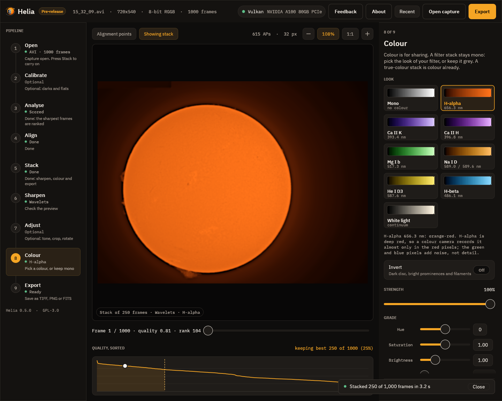
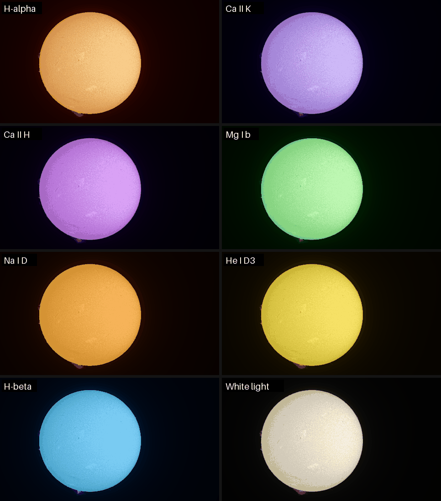

# 8. Colour

> For a stack made with **True colour** (white light, a colour camera) this step
> shows the gains and the channel shifts instead of the look cards: the stack is
> colour already and no look applies.
>
> 

Colour is for sharing. The stack stays mono; the look you choose here is applied to
it when you view and when you export. A narrow-band solar capture is one colour of
light, so the colours are a convention (orange for H-alpha, violet for calcium),
not a measurement. See [Colourising](../user-guide/colourising.md) for the
reasoning.

Each card shows a look as a ramp from black to white, with its filter and
wavelength. Click one and the viewer shows the stack in those colours at once.
Under the cards a line says why the look is what it is.

## Every look

The same stack in each of the eight looks, reduced in size. The first card in the
app, **Mono**, is the stack in grey.

| Look | Wavelength | Colour | Use it for |
|---|---|---|---|
| H-alpha | 656.3 nm | orange-red | The chromosphere: filaments, plage, prominences |
| Ca II K | 393.4 nm | violet | The chromosphere and plage in calcium |
| Ca II H | 396.8 nm | violet, a touch redder | The same, so a K and H pair can be told apart |
| Mg I b | 517.3 nm | green | The lower chromosphere |
| Na I D | 589.0 and 589.6 nm | yellow-orange | Sodium |
| He I D3 | 587.6 nm | yellow | Faint prominences and flares |
| H-beta | 486.1 nm | blue-cyan | The chromosphere in H-beta |
| White light | continuum | warm neutral | The photosphere: sunspots and granulation |

The right look is the one of your filter. The look Helia recommends comes from the
file name, folder, sidecar or header. The app remembers the look you chose for each
filter, so the next capture in the same filter starts with it.

## The two controls

* **Invert** makes a negative before colouring, with a dark disc and bright
  prominences and filaments, which shows prominences well.
* **Strength** mixes between grey (0 per cent) and the full colour (100 per cent).

**Continue to export** goes on.

## The finished picture

Here is the finished full-disc stack: the recommended wavelets, H-alpha colours,
written as it would be to TIFF (this is a reduced copy):

## Next

[Export](09-export.md).
