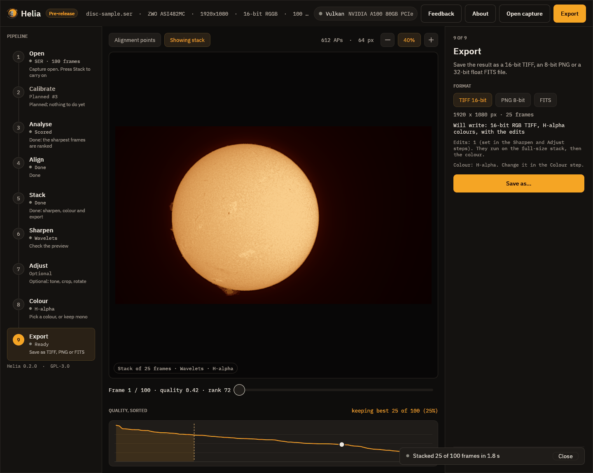

# 9. Export

Choose a format, press **Save as**, and say where to put it. Ctrl+E does the same
from any step.



| Format | What it is | Use it for |
|---|---|---|
| **TIFF 16-bit** | Greyscale or RGB, 16 bits per channel | Your master picture, and any further editing |
| **PNG 8-bit** | Greyscale or RGB, 8 bits per channel | Sharing on the web and in messages |
| **FITS** | 32-bit floating point; mono, or a three-plane cube for a true-colour stack | Measurement and further processing |

The step says exactly what will be written, here *16-bit RGB TIFF, H-alpha colours,
with the edits*, and what produced it: the edits (the number of sharpening and
adjustment operations) and the colour look. The edits run on the full-size stack,
then the colour is applied. Writing happens in the background with a notice, and a
message confirms where the file went.

## What the files say

Every file notes how it was made, so a picture can be repeated and understood
later. For TIFF the note is in the `ImageDescription` tag, for PNG in the
`Description` chunk, and for FITS in `HISTORY` cards. It lists the edits in words
and as a list that can be reused, and the colour look. The Bayer decisions
(including a header that was wrong) are recorded too. See
[What the files say](../user-guide/colourising.md#what-the-files-say).

## FITS and SOLARNET

A FITS file is the **unsharpened** stack, because it is for further processing;
the edits go into TIFF and PNG. Turn on **Edit the FITS too** if you want them in
it, and the step says which it will be. The header carries observation keywords in
the [SOLARNET](https://solarnet-metadata.readthedocs.io/en/stable/) convention,
partially compliant (`SOLARNET = 0.5`), plus what Helia knows of the capture. The details,
including how to give your observing site for the position keywords (`--site`),
are in [Output formats](../reference/output-formats.md#fits).

## From the command line

The extension picks the format:

```sh
helia stack disc-sample.ser -o sun.tif --preset ha --sharpen wavelet
helia stack disc-sample.ser -o sun.png --preset ha --sharpen wavelet
helia stack disc-sample.ser -o sun.fits
```

## Next

[About](10-about.md).
