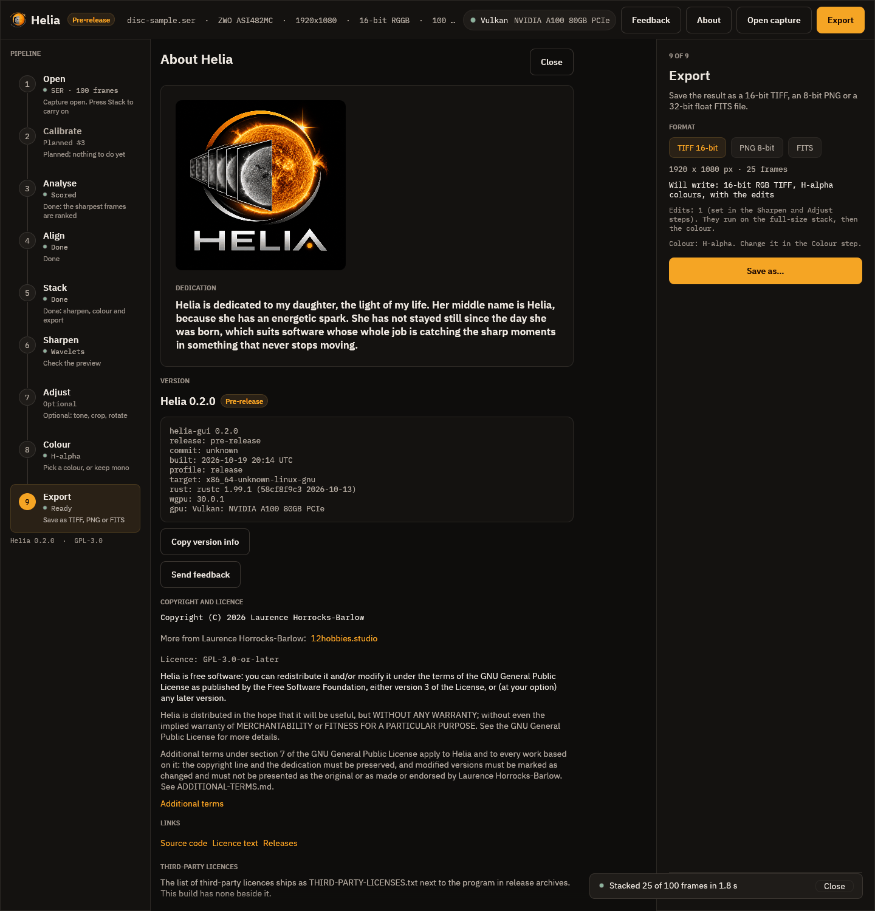

# 10. About

The **About** button in the top bar, or F1, opens the About page, which replaces
the viewer until you press Esc or **Close**.

From the top:

* **The dedication.** Helia is dedicated to the author's daughter, whose middle
  name is Helia. The dedication is part of the licence terms and is preserved in
  every copy.
* **Version.** The version (with a note that it is a pre-release, below 1.0), and how this copy was built: the git commit (with
  `+dirty` if the tree had uncommitted changes), the build time in UTC, the build
  profile, the target, the Rust and wgpu versions, and the graphics adapter in
  use, or CPU. **Copy version info** puts those lines on the clipboard, which is
  what to paste into a bug report. The screenshot is of a test build: a release
  shows its own commit.
* **Copyright and licence.** Helia is free software under the GNU General Public
  Licence version 3 or later, with additional terms under section 7 of that
  licence: the copyright line and the dedication must be kept, and modified
  versions must be marked as changed. The page links to the full text.
* **Links**: the source, the licence text, the releases page and, at the foot,
  the third-party licences. In a release archive that list is
  `THIRD-PARTY-LICENSES.txt` beside the program.

* **Support Helia.** The **Support on Ko-fi** button opens
  [ko-fi.com/qisback](https://ko-fi.com/qisback) in your browser. Helia is free;
  this is only a way to say thanks.

  

The page makes no network connection. A link opens in your browser only when you
click it.

## Next

[Send feedback](feedback.md).
