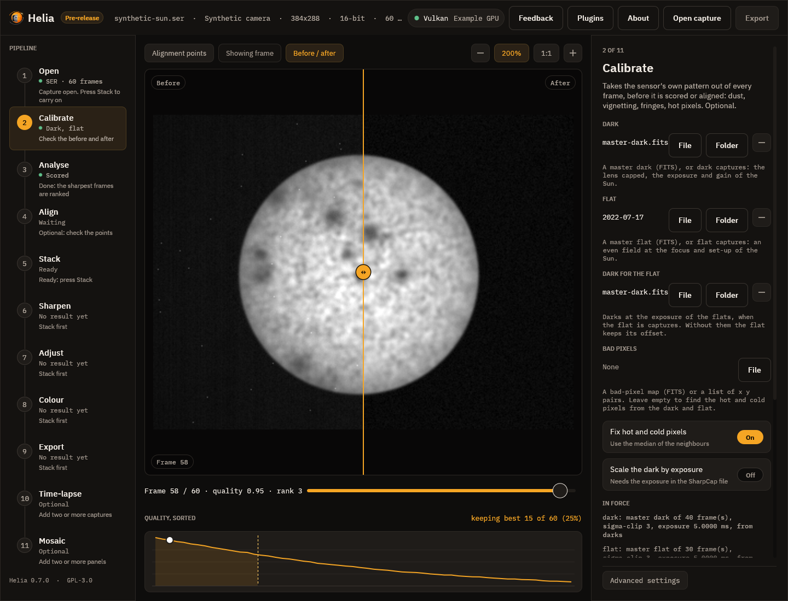

# Calibrate (optional)

The second step in the rail. It is optional, and skipped by the quick stack, but
if you recorded darks and flats it is the first thing to do: everything after it
works on the calibrated frames.

The picture is synthetic on purpose: a sun seen through a sensor with a strong
vignette, dozens of dust shadows, a fixed pattern and sixty hot pixels, which the
masters made from that sensor's own darks and flats take out. On a real capture the
effect is subtler and this is how you check it: drag the line across the picture
and watch the dust, the fall-off at the edge and the speckle in the sky.

## What to do

1. Press **File** under **Dark** and pick a master dark (`master-dark.fits` from
   `helia calibrate`), or **Folder** and pick a folder of dark captures. The rail
   shows **Preparing** while Helia reads or builds it.
2. Do the same for the **Flat**. If the flat is captures, a **Dark for the flat**
   slot appears; give it darks at the exposure of the flats.
3. Leave **Bad pixels** empty and the hot pixels of the dark and the dead pixels of
   the flat are found and replaced, or give your own map.
4. Read what the inspector says under **In force**: how many frames each master
   combines, the exposure and a fingerprint of the pixels, and any warning. A flat
   with Newton rings or an etalon's fringes is flagged here, and so is strong
   vignetting; see [Etalons and Newton rings](../user-guide/calibration.md#etalons-and-newton-rings).
5. Press **Save the masters** to write them to a folder, so that next time you can
   pick the files and skip the combining.
6. Press **Stack** (or **Stack with recommended settings**) as usual. The frames
   are scored, aligned and stacked after calibration, and the file records the
   masters.

A master must come from the same camera, mode and region as the capture; Helia
refuses a mismatch and says which. Changing a file scores the capture again, and a
stack made before the change is out of date.

A worked example with every command, the numbers and the troubleshooting is in the
[calibration tutorial](../tutorials/calibrate.md).

## Next

[Analyse](03-analyse.md).
